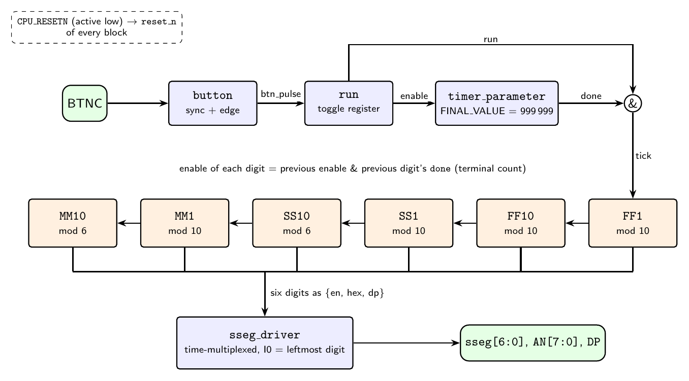

# ECE 3300L — Lab 6 Review: Stopwatch

**Name:** <!-- TODO: your name -->
**Course:** ECE 3300L, Cal Poly Pomona
**Board:** Digilent Nexys A7-100T (Artix-7), Vivado

## 1. Objective

Build a stopwatch on the Nexys A7 that shows `MM.SS.FF` (minutes 00–59, seconds 00–59, hundredths 00–99) on the seven-segment display. The center button (`BTNC`) toggles start / pause / continue, and the CPU reset button (`CPU_RESETN`) resets the stopwatch. Everything else was left to us, so we chose and documented our own behavior (section 3).

The lab is a capstone for the earlier ones. It reuses the time-multiplexed `sseg_driver` from Lab 5, the button conditioner from Lab 4, and the counter and timer starter modules provided for this lab.

## 2. What we built

### Architecture

<!-- TODO: embed your block diagram, e.g.  -->

The design is one top-level module, `stopwatch.v`, wiring together provided modules. The only new logic is the `run` register, the tick gating, and the enable chain between the digits.

**Start / pause.** `button.v` turns a press of `BTNC` into a one-clock pulse. Each pulse toggles a 1-bit `run` register, which is reset to 0 so the stopwatch starts stopped.

**0.01 s tick.** The board clock is 100 MHz, so a `timer_parameter` with `FINAL_VALUE = 999,999` pulses `done` once every 1,000,000 clocks, which is 10 ms. The timer is enabled by `run`. We use this pulse as a counter *enable*, not as a derived clock, which keeps the whole design in one clock domain.

**Digit chain.** Six counters are cascaded, each enabled by the previous stage's enable ANDed with its terminal count:

| Digit | Range | Module |
|---|---|---|
| FF ones, FF tens | 0–9 | `BCD_counter` |
| SS ones | 0–9 | `BCD_counter` |
| SS tens | 0–5 | `mod_counter_input` (`FINAL_VALUE = 5`) |
| MM ones | 0–9 | `BCD_counter` |
| MM tens | 0–5 | `mod_counter_input` (`FINAL_VALUE = 5`) |

`BCD_counter` is hard-wired to 9, so the two mod-6 digits needed a different module. We used `mod_counter_input`, which has no `done` port, so the terminal count is computed in the top module as `Q == 5`.

**Display.** The six BCD digits feed the Lab 5 `sseg_driver`. Its inputs are `{enable, hex[3:0], dp}`, with `I0` as the leftmost digit. We blank `I0` and `I7` and use `I1`–`I6` for `MM SS FF`, with the decimal point on after the minutes and seconds ones digits.

**Reset.** `CPU_RESETN` is active-low and drives `reset_n` on every counter, the timer, the display, and `run`.

## 3. Design decisions and assumptions

- The two outer display digits are blanked, so the time sits in the middle six.
- Reset leaves the stopwatch stopped at `00.00.00`; it starts only when `BTNC` is pressed.
- After `59.59.99` the stopwatch wraps to `00.00.00` and keeps running.
- The tick is `done & run`, not just `done`. `timer_parameter`'s `done` is a level (`Q == FINAL_VALUE`) and stays high while the timer is frozen at its final value. If a pause landed on that cycle, ungated `done` would keep ticking the counters.
- `TICK_FINAL` is a parameter on the top module so the testbench can shrink the tick from 1,000,000 clocks to 4.

## 4. Verification

### Simulation

The testbench (`stopwatch_tp.v`, module `stopwatch_tb`) instantiates the design as `uut` with `TICK_FINAL = 3`. It reads the digits through hierarchical references and checks:

1. The stopwatch stays at `00.00.00` after reset until `BTNC` is pressed.
2. Start, then count to `00.00.05`.
3. Pause: the value holds for 200 clocks.
4. Continue: counting resumes.
5. Carries `FF -> SS` (`00.00.99 -> 00.01.00`), `SS -> MM` (`00.59.99 -> 01.00.00`), and the full wrap `59.59.99 -> 00.00.00`.
6. `CPU_RESETN` during a run clears the time and stops the count.

Simulating a full minute takes about 24,000 clocks, and the full 60-minute wrap would take about 1.4 million. So for the carry checks the testbench jumps the counters to a value just before the rollover by writing their `Q_reg` registers directly (simulation only, done on a falling clock edge to avoid racing the counters). A 2 ms watchdog stops the run if a `wait` hangs.

<!-- TODO: embed testbench output, e.g.

-->

### Hardware

We programmed the board and confirmed that the display shows `00.00.00` after reset, `BTNC` starts and pauses the count, `CPU_RESETN` resets it, and rollovers happen as expected.

<!-- TODO: add links to your demo videos, e.g.
- Start / pause / continue / reset: <link>
- Seconds and minutes rollover: <link>
-->

## 5. Problems we ran into

**1. Simulation that would not finish.** The first time we ran the testbench, `run all` kept going to seconds of simulated time. Two causes stacked up. The simulator was running a stale snapshot of an older testbench, so the new watchdog was not in effect. The fix was to close the simulation and relaunch with **Run Behavioral Simulation** rather than `restart`, and to confirm `stopwatch_tb` was set as the simulation top. Separately, `run 1 ms` is a safe bounded alternative to `run all` while debugging.

**2. Stopwatch stuck at `00.00.00` on the board.** The first bitstream displayed zeros and never counted; only the reset button did anything. The display was fine and reset worked, which pointed us toward the button and timer first. The real cause was in the top module: the six per-digit enable wires (`e_ff1 … e_mm10`) were declared but never assigned. Synthesis treats an undriven net as constant 0, so no counter ever received an enable. Adding the six `assign` statements for the enable chain fixed it.

Our first suspect was button bounce, because `button.v` is a 3-sample shift register and not a true debouncer. That was a reasonable hypothesis but wrong here. It is worth keeping in mind (section 6), but the fix did not need it.

## 6. Observations and limitations

- **Check the synthesis warnings.** Vivado almost certainly warned about the undriven enable nets. Reading the Messages tab before going to hardware would have saved the debugging time. This is the main lesson of the lab.
- **Button debouncing.** `button.v` samples at 100 MHz and requires only two consecutive high samples, so contact bounce on a real press can produce more than one pulse and toggle `run` more than once. It behaved correctly in our testing, but a counter-based debounce stage (accept a new level only after it has been stable for around 10 ms) would make it robust.
- **Timer width pitfall.** `timer_parameter` and `mod_counter_parameter` size their counter with `$clog2(FINAL_VALUE)`, which is one bit too small when `FINAL_VALUE` is an exact power of two (for example 4 or 8), so `done` never fires. Our values, `999,999` and `3`, are safe. For simulation, `3` is the smallest tick that works.
- **Enable-based design.** Using one clock and passing `done` pulses as enables made the cascade easy to reason about and to test, compared with generating slower derived clocks.

## 7. Files

| File | Description |
|---|---|
| `stopwatch.v` | Top-level module (new) |
| `stopwatch_tp.v` | Testbench, module `stopwatch_tb` (new) |
| `stopwatch.xdc` | Pin constraints for the Nexys A7-100T (new) |
| `sseg_driver.v`, `hex2sseg.v`, `decoder_generic.v` | Seven-segment driver (from Lab 5) |
| `BCD_counter.v`, `mod_counter_input.v`, `timer_parameter.v`, `udl_counter.v` | Provided starter modules (unmodified) |
| `button.v` | Provided button conditioner (unmodified) |

## 8. Takeaways

- Cascading counters with enables (`enable_n = enable_{n-1} & done_{n-1}`) scales cleanly to any mixed-radix display such as minutes and seconds.
- Gate any level-type `done` flag with its enable before using it as a tick.
- A testbench should use a scaled-down tick and preload counters near rollovers so each case runs in microseconds.
- Read the synthesis warnings first. An undriven net looks exactly like a logic bug on the board.