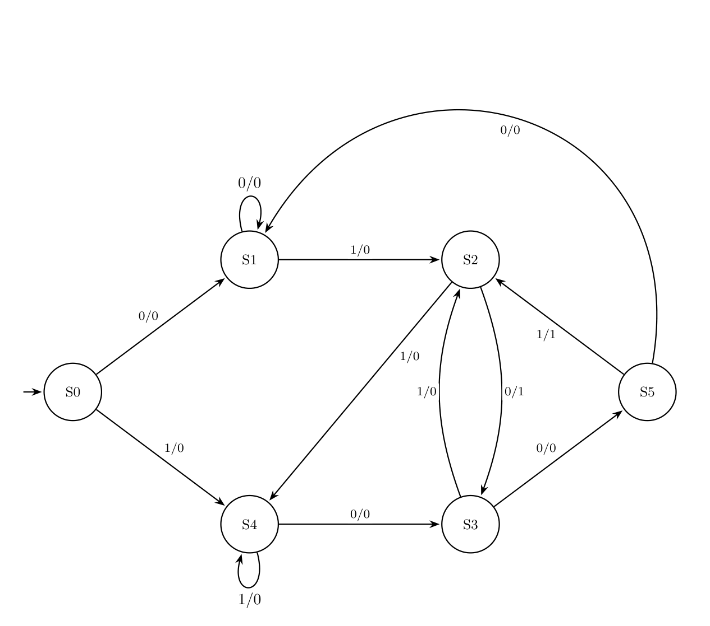
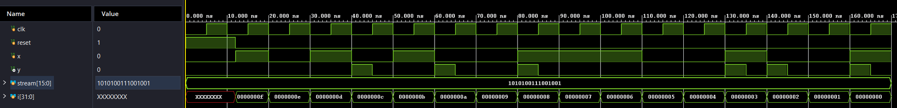
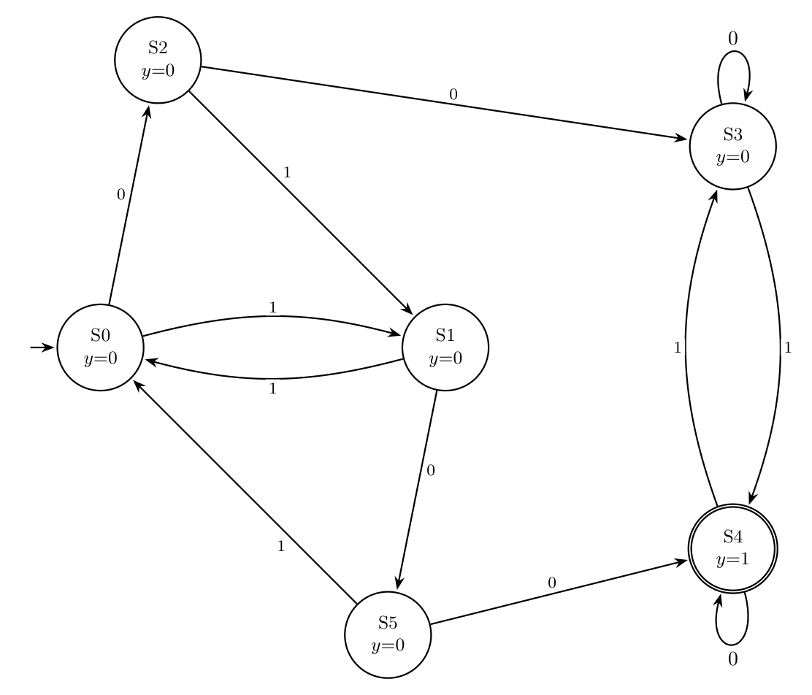
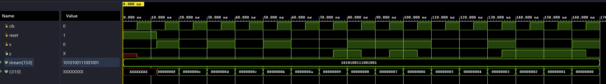
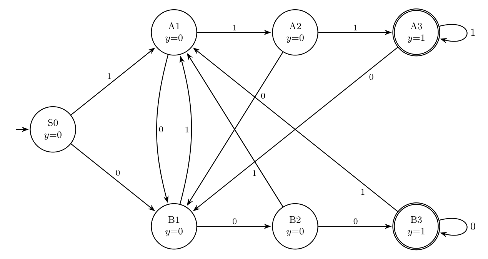
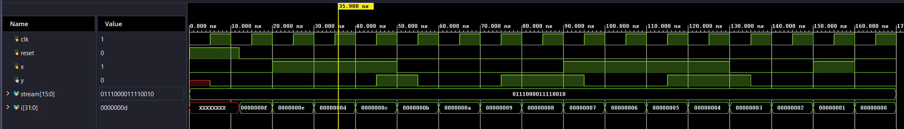

# ECE 3300L Lab 7 — Finite State Machines

Three FSMs written in Verilog and verified by simulation in Vivado. There is no FPGA implementation in this lab.

| Part | Module | Testbench | Type |
|------|--------|-----------|------|
| 1a | `dual_sequence_detector.v` | `dual_sequence_detector_tb.v` | Mealy |
| 1b | `even_odd_conseq00.v` | `even_odd_conseq00_tb.v` | Moore |
| 2 | `conseq_sequence.v` | `conseq_sequence_tb.v` | Moore |

Design sources are in `Lab7.srcs/sources_1/new/`, testbenches in `Lab7.srcs/sim_1/new/`. The state diagrams were drawn with TikZ (sources in `diagrams/`).

All three modules share the same structure: a 3-bit state register with a synchronous, active-high `reset`, a combinational next-state `case` block, and an output that is either a function of the state alone (Moore) or of the state and `x` (Mealy).

Each testbench resets the FSM, then applies a fixed 16-bit stream (MSB first) one bit per clock. `x` changes on the falling clock edge and the state updates on the next rising edge. The clock period is 10 ns (rising edges at 5, 15, 25, ... ns).

---

## Part 1a — `dual_sequence_detector` (Mealy)

**Specification:** One input `x`, one Mealy output `y`. `y = 1` whenever the input ends in `010` or `1001`. Overlapping sequences are allowed, so the FSM never resets after a detection.

The two sequences share states: S2 means "`01`" and S3 means "`010` or `10`". S5 is needed only for `100`.

### State diagram

Edges are labelled `x/y`.



### State table

| State | Meaning | x=0 → next / y | x=1 → next / y |
|-------|---------|----------------|----------------|
| S0 | reset | S1 / 0 | S4 / 0 |
| S1 | last bit was 0 | S1 / 0 | S2 / 0 |
| S2 | `01` | S3 / **1** | S4 / 0 |
| S3 | `010` or `10` | S5 / 0 | S2 / 0 |
| S4 | last bit was 1 | S3 / 0 | S4 / 0 |
| S5 | `100` | S1 / 0 | S2 / **1** |

### Simulation

Test stream: `1010100111001001`. Because `y` is a Mealy output it responds as soon as `x` changes, so it pulses between the falling edge where `x` changes and the next rising edge. Expected pulses (the bit on which the sequence completes):

| Bit | 4 | 6 | 8 | 13 | 14 | 16 |
|-----|---|---|---|----|----|----|
| Sequence (bits) | `010` (2–4) | `010` (4–6, overlaps bit 4) | `1001` (5–8) | `1001` (10–13) | `010` (12–14, overlaps bits 12–13) | `1001` (13–16, overlaps bit 13) |
| `y` high from | 40 ns | 60 ns | 80 ns | 130 ns | 140 ns | 160 ns |
| `y` low again at | 45 ns | 65 ns | 85 ns | 135 ns | 145 ns | 165 ns |



The waveform shows `y` high for 5 ns at 40, 60, 80, 130, 140 and 160 ns, matching the table above. Reset is released at 12 ns, and `x` follows the test stream one bit per clock.

---

## Part 1b — `even_odd_conseq00` (Moore)

**Specification:** One input `x`, one Moore output `y`. `y = 1` when the total number of 1s received since reset is odd, but only after two consecutive 0s have been seen at least once. Before the first `00`, `y` is always 0. After the first `00` the machine stays in S3/S4 forever and each 1 toggles `y`.

States S0–S2 and S5 track the parity of the 1s while waiting for the first `00`. A single 0 moves to S2 (even) or S5 (odd); a second 0 enters the `00`-seen pair S3 (even) or S4 (odd). Zero ones counts as even.

### State diagram

Edges are labelled with `x`. The output is shown inside each state; S4, the only state with `y = 1`, has a double ring.



### State table

| State | Meaning | y | x=0 → next | x=1 → next |
|-------|---------|---|------------|------------|
| S0 | reset, even 1s, no `00` yet | 0 | S2 | S1 |
| S1 | odd 1s, no `00` yet | 0 | S5 | S0 |
| S2 | even 1s, one 0 just seen | 0 | S3 | S1 |
| S3 | even 1s, `00` seen | 0 | S3 | S4 |
| S4 | odd 1s, `00` seen | **1** | S4 | S3 |
| S5 | odd 1s, one 0 just seen | 0 | S4 | S0 |

### Simulation

Test stream: `1010100111001001`. `y` is a Moore output, so it changes just after a rising clock edge. The first `00` ends at bit 7, with three 1s so far (odd), so `y` first goes high there; after that every 1 toggles it.

| Bit | 1–6 | 7 | 8 | 9 | 10 | 11–12 | 13 | 14 | 15 | 16 |
|-----|-----|---|---|---|----|-------|----|----|----|----|
| `x` | 101010 | 0 | 1 | 1 | 1 | 00 | 1 | 0 | 0 | 1 |
| 1s so far | | 3 | 4 | 5 | 6 | 6 | 7 | 7 | 7 | 8 |
| `y` | 0 | **1** | 0 | **1** | 0 | 0 | **1** | **1** | **1** | 0 |

`y` is high from 75–85 ns, 95–105 ns, and 135–165 ns.



The waveform shows `y` high at 75–85, 95–105 and 135–165 ns, matching the table above. Reset is released at 12 ns, and `x` follows the test stream one bit per clock. `y` is unknown (`X`) until the first clock edge with reset applied.

---

## Part 2 — `conseq_sequence` (Moore)

**Specification:** One input `x` and one output `y`. `y` is asserted whenever `x` has been 1, or 0, for three consecutive clock pulses (the sequences `111` and `000`). Overlapping sequences are allowed, so four or five equal bits in a row also give `y = 1`.

I chose a Moore design. A Moore output cannot depend on `x`, so "the third equal bit has arrived" needs its own state, separate from "two in a row". That makes 7 states:

- `S0` — reset, no history
- `A1`, `A2`, `A3` — one, two, three-or-more 1s in a row (`A3` has `y = 1`)
- `B1`, `B2`, `B3` — one, two, three-or-more 0s in a row (`B3` has `y = 1`)

`A3` and `B3` loop on a matching bit, which handles the overlap case. Any bit that breaks the run moves to `B1` (after a 1-run) or `A1` (after a 0-run). Seven states need 3 flip-flops.

### State diagram

Edges are labelled with `x`. The output is shown inside each state; `A3` and `B3` (`y = 1`) have double rings.



### State table

| State | Meaning | y | x=0 → next | x=1 → next |
|-------|---------|---|------------|------------|
| S0 | reset, no history | 0 | B1 | A1 |
| A1 | one 1 in a row | 0 | B1 | A2 |
| A2 | two 1s in a row | 0 | B1 | A3 |
| A3 | three or more 1s | **1** | B1 | A3 |
| B1 | one 0 in a row | 0 | B2 | A1 |
| B2 | two 0s in a row | 0 | B3 | A1 |
| B3 | three or more 0s | **1** | B3 | A1 |

### Simulation

Test stream: `0111000011110010`.

| Bit | 1 | 2 | 3 | 4 | 5 | 6 | 7 | 8 | 9 | 10 | 11 | 12 | 13 | 14 | 15 | 16 |
|-----|---|---|---|---|---|---|---|---|---|----|----|----|----|----|----|----|
| `x` | 0 | 1 | 1 | 1 | 0 | 0 | 0 | 0 | 1 | 1 | 1 | 1 | 0 | 0 | 1 | 0 |
| `y` | 0 | 0 | 0 | **1** | 0 | 0 | **1** | **1** | 0 | 0 | **1** | **1** | 0 | 0 | 0 | 0 |

`y` rises on the third equal bit (bits 4, 7, 11), stays high for the fourth bit of the run (bits 8, 12, the overlap case), and drops as soon as the run breaks. `y` is high from 45–55 ns, 75–95 ns, and 115–135 ns.



The waveform shows `y` high at 45–55, 75–95 and 115–135 ns, matching the table above. Reset is released at 12 ns, and `x` follows the test stream one bit per clock.

---

## Files

```
Lab7/
├── README.md
├── images/       state diagrams (PNG) and simulation screenshots
├── diagrams/     TikZ sources for the state diagrams
└── Lab7.srcs/
    ├── sources_1/new/   dual_sequence_detector.v, even_odd_conseq00.v, conseq_sequence.v
    └── sim_1/new/       dual_sequence_detector_tb.v, even_odd_conseq00_tb.v, conseq_sequence_tb.v
```

## Submission checklist

- [x] All Verilog code written
- [x] All testbenches written
- [x] Testbench output screenshots embedded in this README (3 of 3)
- [x] State diagrams embedded in this README (3 diagrams)
