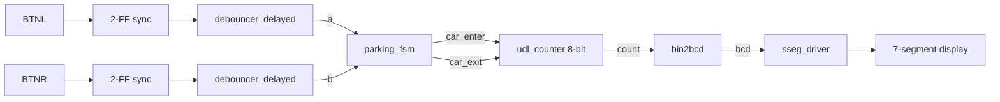
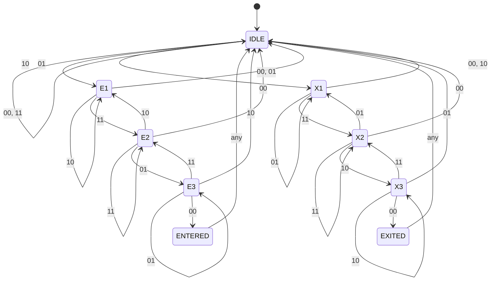

# ECE3300L Lab 8: Parking Lot Occupancy Counter

## Overview

Two sensors, `a` and `b`, watch a single entry/exit gate. The order in which they fire tells a car entering from a car exiting or a pedestrian walking through. An FSM turns that order into one-clock-cycle pulses (`car_enter`, `car_exit`). A single up/down counter tracks occupancy and shows it on the Nexys A7 seven-segment display. Two debounced pushbuttons stand in for the sensors (`BTNL` = a, `BTNR` = b).

| `ab` sequence | Meaning | Result |
|---|---|---|
| `00 → 10 → 11 → 01 → 00` | Car enters | `car_enter` pulses, count + 1 |
| `00 → 01 → 11 → 10 → 00` | Car exits | `car_exit` pulses, count - 1 |
| Anything else (e.g. `00 → 10 → 00`) | Pedestrian or aborted car | No pulse |

## Block diagram

- `up = car_enter`; counter `enable` is high only on a `car_enter` or `car_exit` pulse.
- The count saturates: an exit at 0 and an enter at 255 are ignored (the starter `udl_counter` would otherwise wrap).
- Hundreds, tens and ones appear on the three rightmost digits.

## State diagram (`parking_fsm`)

A Moore machine with 9 states. `ENTERED` and `EXITED` each last exactly one clock and return to `IDLE`, which guarantees a one-cycle output pulse. Edge labels are the value of `ab`.

### State table

| State | Meaning | `car_enter` | `car_exit` |
|---|---|---|---|
| `IDLE` | Both sensors off, waiting | 0 | 0 |
| `E1` | Enter path, `a` only (10) | 0 | 0 |
| `E2` | Enter path, both (11) | 0 | 0 |
| `E3` | Enter path, `b` only (01) | 0 | 0 |
| `ENTERED` | Car entered (one-cycle pulse) | 1 | 0 |
| `X1` | Exit path, `b` only (01) | 0 | 0 |
| `X2` | Exit path, both (11) | 0 | 0 |
| `X3` | Exit path, `a` only (10) | 0 | 0 |
| `EXITED` | Car exited (one-cycle pulse) | 0 | 1 |

Design choices:
- **Moore outputs:** outputs come straight from the state register, so they are glitch-free and can never both be 1. The pulse appears one clock after the final `00` is seen.
- **Backing up:** `E2` on `10` returns to `E1` (and `X2` on `01` to `X1`), so a car that reverses is not counted.
- **Invalid jumps:** any input that skips a step in the sequence returns to `IDLE` with no count.

## Files

| File | Description |
|---|---|
| `parking_fsm.v` | Entry/exit detection FSM |
| `parking_fsm_tb.v` | FSM testbench (waveform only) |
| `parking_lot_top.v` | Top level: synchronizers, debouncers, FSM, counter, display |
| `parking_lot_top.xdc` | Nexys A7 constraints |
| `debouncer_delayed.v`, `debouncer_delayed_fsm.v` | 20 ms delayed debouncer (starter code) |
| `udl_counter.v` | Up/down/load counter (starter code) |
| `timer_parameter.v` | Timer used by the debouncer (Lab 6) |
| `sseg_driver.v`, `hex2sseg.v`, `decoder_generic.v` | Seven-segment driver (Labs 3 and 5) |
| `bin2bcd.v`, `add_3.v` | Binary to BCD (Lab 2) |

## Simulation

`parking_fsm_tb.v` applies seven scenarios, each holding every `ab` value for 3 clocks:

1. Car enters
2. Car exits
3. Pedestrian via `a` only
4. Pedestrian via `b` only
5. Car starts to enter, then backs out (`00 → 10 → 11 → 10 → 00`)
6. Two cars enter back to back
7. Reset in the middle of a sequence

Expected: `car_enter` pulses once in case 1 and twice in case 6; `car_exit` pulses once in case 2; nothing in cases 3, 4, 5 and 7. Each pulse is one clock wide.

## Hardware demonstration

Controls: `BTNL` = sensor a, `BTNR` = sensor b, `CPU_RESETN` = reset (count returns to 000).

| Action | Expected display |
|---|---|
| Hold BTNL, add BTNR, release BTNL, release BTNR (car enters) | 000 → 001 |
| Hold BTNR, add BTNL, release BTNR, release BTNL (car exits) | 001 → 000 |
| Exit while at 000 | Stays 000 |
| Tap BTNL alone (pedestrian) | No change |

Hold each button state for a moment so the 20 ms debouncer settles.

## Notes

- A 2-flip-flop synchronizer was added in front of each debouncer; the starter debouncer samples its input directly.
- The counter is 8 bits (0-255) and saturates at both ends.
