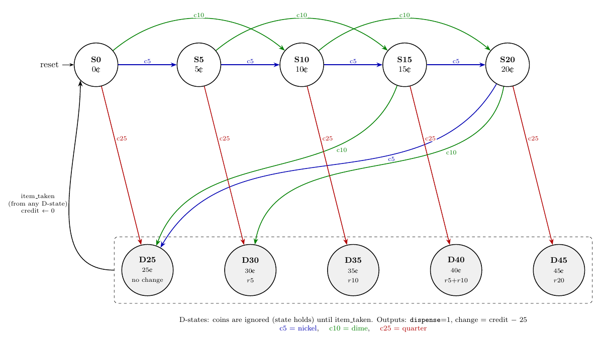
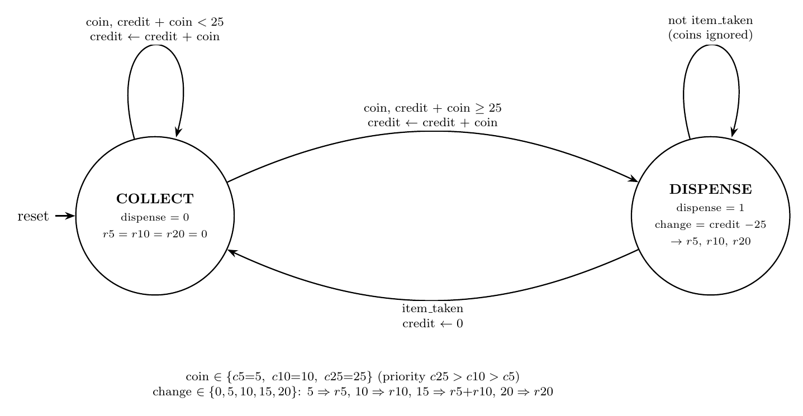
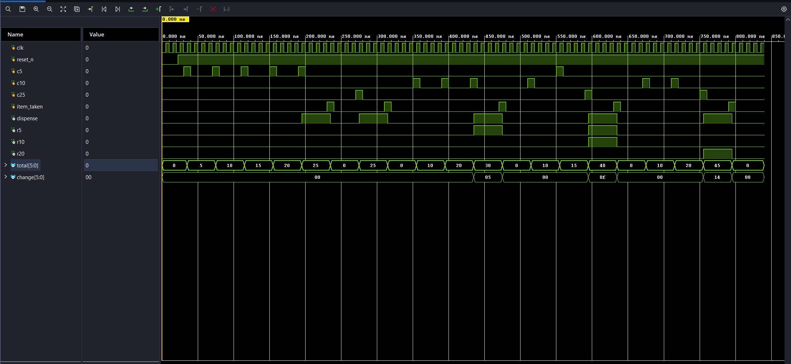

# ECE3300L Lab 9 — Vending Machine FSM

Vending-machine controller for the Nexys A7. The machine sells one item for **25 cents** and accepts nickels (5¢), dimes (10¢) and quarters (25¢). Once enough credit is inserted it dispenses the item and returns any change, then waits for the item to be taken before accepting coins for the next sale.

## Specification

| Signal | Dir | Meaning |
|---|---|---|
| `c5`, `c10`, `c25` | in | Nickel / dime / quarter inserted (one-clock pulse) |
| `item_taken` | in | Dispensed item has been collected (one-clock pulse) |
| `dispense` | out | Item is being dispensed |
| `r5` | out | Return one nickel |
| `r10` | out | Return one dime |
| `r20` | out | Return two dimes |

## Design decisions

The handout leaves these open, so the design fixes them as follows:

- **Pulse inputs:** each pushbutton goes through the starter `button` module (debouncer + edge detector); its `p_edge` output is a one-clock coin/`item_taken` pulse.
- **Simultaneous coins:** priority `c25 > c10 > c5` (only one coin is counted per clock).
- **Coins during dispense:** ignored until `item_taken`.
- **Credit range:** 0–45¢ (worst case is 20¢ + a quarter). A 6-bit register holds it.
- **Change:** possible values are 0, 5, 10, 15, 20¢, output all at once (Moore outputs):

  | Change | Outputs |
  |---|---|
  | 5¢ | `r5` |
  | 10¢ | `r10` |
  | 15¢ | `r5` + `r10` |
  | 20¢ | `r20` |

- **After `item_taken`:** credit clears and the FSM returns to `COLLECT`.
- **Reset:** asynchronous, active-low (`CPU_RESETN`); clears credit and returns to `COLLECT`.

## State diagram

### Full state diagram (every credit value)



Each reachable credit amount is its own state. `S0`–`S20` are the accepting states (credit 0–20¢); `D25`–`D45` are the dispensing states (credit 25–45¢). Edges are colored by coin: blue = nickel (`c5`), green = dime (`c10`), red = quarter (`c25`). From every D-state, `item_taken` returns to `S0`; coins are ignored there.

| From | `c5` | `c10` | `c25` | Outputs |
|---|---|---|---|---|
| S0 (0¢) | S5 | S10 | D25 | none |
| S5 (5¢) | S10 | S15 | D30 | none |
| S10 (10¢) | S15 | S20 | D35 | none |
| S15 (15¢) | S20 | D25 | D40 | none |
| S20 (20¢) | D25 | D30 | D45 | none |
| D25 | — | — | — | `dispense` |
| D30 | — | — | — | `dispense`, `r5` |
| D35 | — | — | — | `dispense`, `r10` |
| D40 | — | — | — | `dispense`, `r5`, `r10` |
| D45 | — | — | — | `dispense`, `r20` |

### Simplified diagram



The Verilog implements the same behavior with two states plus a 6-bit credit register. The diagrams are drawn in LaTeX/TikZ; the sources are `images/state_diagram_full.tex` and `images/state_diagram.tex`.

| Simplified state | Outputs | Next state |
|---|---|---|
| `COLLECT` | `dispense=0` | stays while credit < 25 |
| `DISPENSE` | `dispense=1` | returns to `COLLECT` on `item_taken` |

The simplified FSM has two states plus a credit register:

| State | Outputs | Next state |
|---|---|---|
| `COLLECT` | `dispense=0`, `r5=r10=r20=0` | Add the coin to credit; go to `DISPENSE` if the new credit ≥ 25, else stay |
| `DISPENSE` | `dispense=1`, change = credit − 25 drives `r5`/`r10`/`r20` | `item_taken` → clear credit, go to `COLLECT`; otherwise stay (coins ignored) |

## Block diagram

```
 BTNL --> button --c5--\
 BTNC --> button --c10--+--> vending_fsm --> dispense, r5, r10, r20 --> LED[3:0]
 BTNR --> button --c25--+        |    \--> total, change --> seg7_display --> AN/SEG
 BTNU --> button --item_taken---/    \--> r5/r10/r20/dispense --> rgb_driver x2 --> LD16, LD17
```

## Files

| File | Description |
|---|---|
| `vending_fsm.v` | Vending-machine FSM and credit register |
| `vending_top.v` | Top level: buttons, FSM, display, LEDs |
| `seg7_display.v` | 8-digit multiplexed seven-segment driver (total on the left, change on the right) |
| `vending_fsm_tb.v` | Testbench (stimulus for waveform) |
| `Vending_Machine.xdc` | Nexys A7 constraints |
| `button.v`, `debouncer_delayed.v`, `debouncer_delayed_fsm.v`, `edge_detector.v` | Starter code: button conditioning |
| `timer_parameter.v`, `timer_input.v`, `pwm_improved.v`, `rgb_driver.v` | Starter code: timers and RGB PWM |

All sources are in `Lab9.srcs/`.

## FPGA implementation (Nexys A7)

| Control | Function |
|---|---|
| `BTNL` | Insert nickel (`c5`) |
| `BTNC` | Insert dime (`c10`) |
| `BTNR` | Insert quarter (`c25`) |
| `BTNU` | Item taken (`item_taken`) |
| `CPU RESET` | Reset |

| Output | Function |
|---|---|
| `LED0` / `LED1` / `LED2` | `r5` / `r10` / `r20` |
| `LED3` | `dispense` |
| RGB `LD16` | Blue = accepting coins, green = dispensing |
| RGB `LD17` | Change due: red = 5¢, yellow = 10¢, magenta = 15¢, cyan = 20¢, off = none |
| Seven-segment (left digits) | Total inserted |
| Seven-segment (right digits) | Change due (blank when none) |

## Simulation

`vending_fsm_tb.v` drives one-clock coin pulses into the FSM (instance `uut`) through these scenarios:

| Scenario | Total | Change |
|---|---|---|
| 5 × nickel | 25¢ | none |
| quarter | 25¢ | none |
| 3 × dime | 30¢ | 5¢ (`r5`) |
| dime + nickel + quarter | 40¢ | 15¢ (`r5` + `r10`) |
| 2 × dime + quarter | 45¢ | 20¢ (`r20`) |

`item_taken` is pulsed after each sale.



## Demo videos

> **TODO:** add links/files for the FPGA demos:
> - Exact payment (no change)
> - Change of 5¢, 10¢, 15¢ and 20¢
> - Coins ignored while dispensing, then reset after `item_taken`
